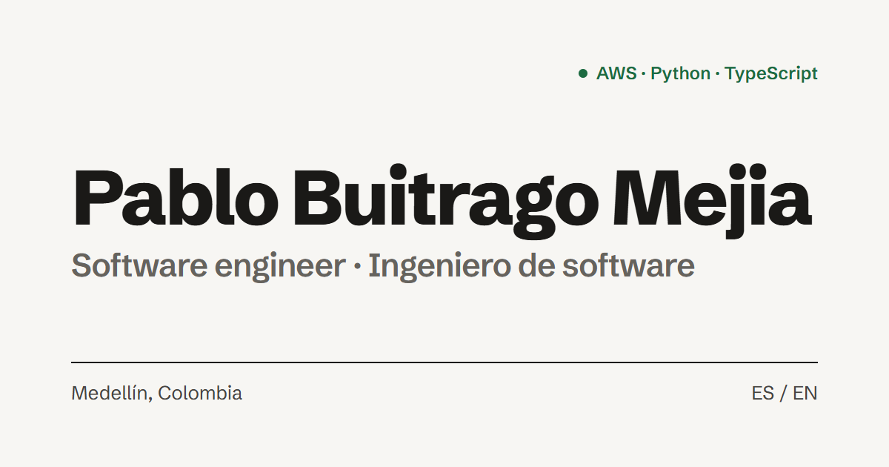
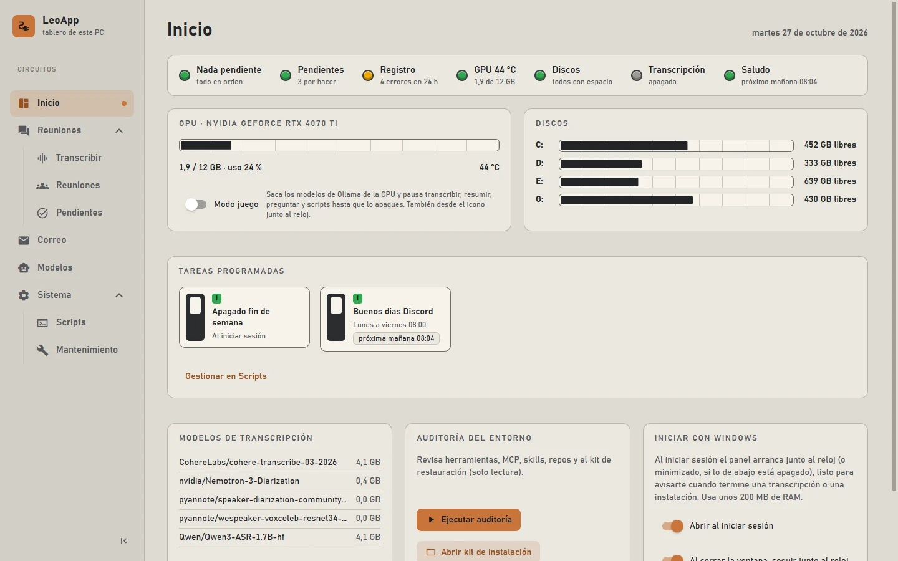
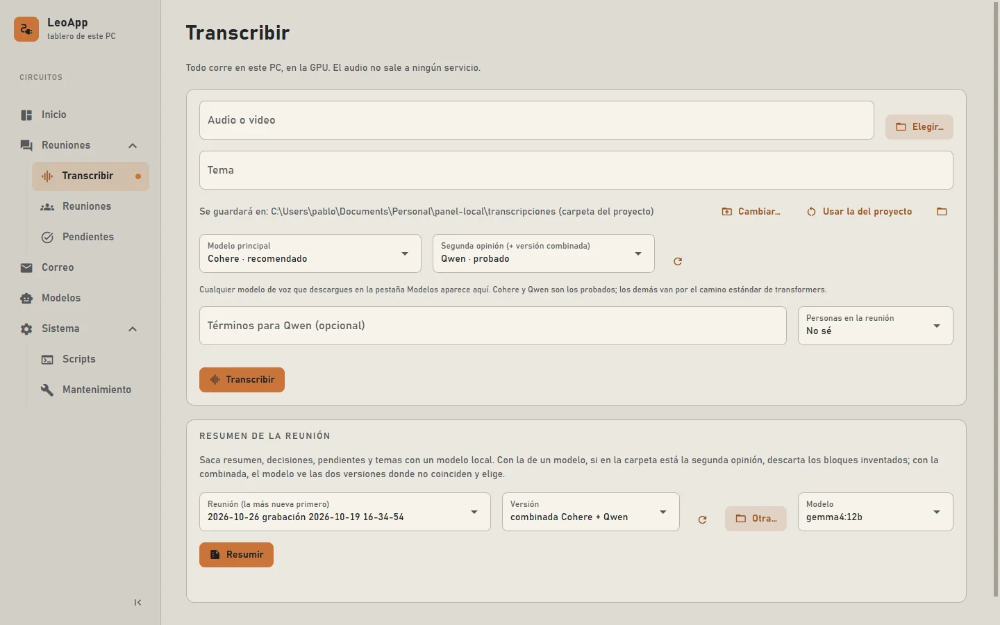
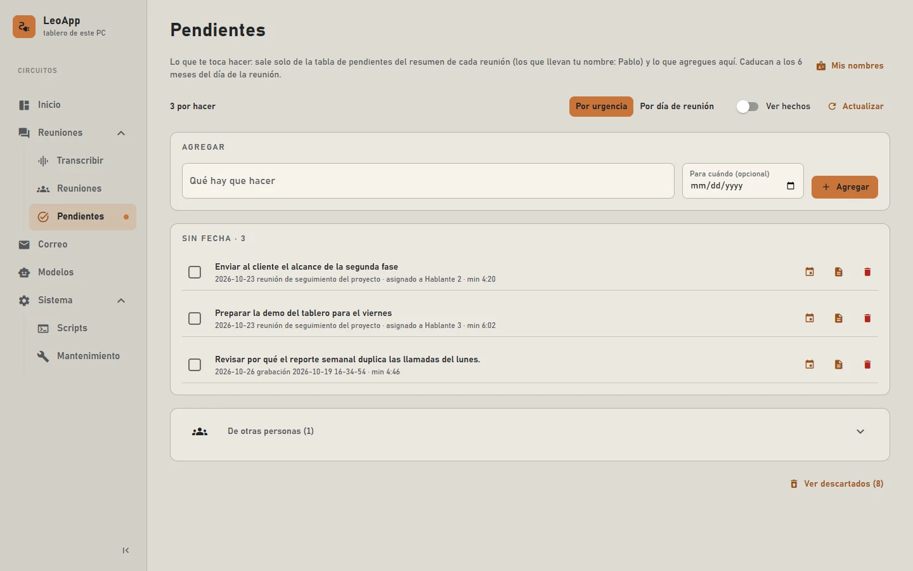

### Ingeniero de software. Backends en AWS, facturación y agentes de voz.

Llevo los sistemas de punta a punta, desde la regla de negocio hasta el despliegue. 
Hoy construyo la facturación y la analítica de una plataforma de contact center con IA para el sector salud.

## Ahora · Boston Project

Plataforma de contact center con IA para clínicas y prestadores de salud: agentes de voz, chat y WhatsApp, y una
consola donde los clientes ven reportes, consumo y facturas.

<table>
  <tr>
    <td align="center" width="33%"><h2>24</h2>funciones Lambda en el backend donde construí la facturación mensual</td>
    <td align="center" width="33%"><h2>7</h2>integraciones externas en ese backend, de AWS Billing a WhatsApp</td>
    <td align="center" width="33%"><h2>9</h2>herramientas en el agente de voz que agenda citas (en desarrollo)</td>
  </tr>
</table>

## Experiencia

**Ingeniero de software · Cloud, datos e IA** — Boston Project &nbsp;`08/2026 – hoy` &nbsp;
- Responsable de la facturación de la plataforma: el cálculo mensual, la revisión y la emisión, del backend a las pantallas.
- Construí la analítica del call center sobre los registros de Amazon Connect.
- Creé el agente de voz de una clínica y ajusté los agentes de otros clientes después de sus primeras jornadas con pacientes.

**Software Development Engineer** — Stellion Tech S.A.S. &nbsp;`09/2022 – 01/2026`
- Gestioné y optimicé bases de datos SQL y NoSQL en producción.
- Implementé infraestructura como código en AWS y apoyé los despliegues.
- Desarrollé aplicaciones web con React, Vite y TypeScript.
- Mantuve y amplié, sobre código heredado, apps en React y Flutter, y publiqué sus versiones en Google Play.

**Desarrollador freelance** — InGrapes &nbsp;`11/2021 – 12/2021`
- Landing page comercial con componentes React reutilizables para que fuera fácil de ampliar.

## Casos

Los clientes se describen de forma genérica por confidencialidad. Despliega cada caso para ver mi aporte y el resultado.

<b>Ciclo de facturación mensual automático</b> · Boston Project

 

Cada mes había que cobrarle a cada cliente lo que de verdad consumió en AWS y en llamadas, según su contrato, y poder
explicar de dónde salía cada cifra.

**Mi aporte:** escribí la mayor parte de la facturación: las reglas de negocio, el código y las pruebas.

**Resultado:**
- Un ciclo mensual que acumula el consumo cada día y genera un borrador que una persona revisa antes de emitir.
- Una vez emitida, la factura ya no se puede modificar y queda con una huella para verificarla.
- El costo de AWS se reparte entre los clientes según su consumo real.
- La factura y su conciliación llegan al cliente en PDF por correo.

`Python` `AWS Lambda` `SAM` `EventBridge` `SQS` `DynamoDB` `S3` `Cost Explorer` `Billing API`

<b>Consola de clientes y reportería</b> · Boston Project

 

Los clientes necesitaban ver su consumo, sus llamadas y su facturación sin acceder a la infraestructura, y el equipo
interno necesitaba operar la facturación desde la misma herramienta.

**Mi aporte:** construí las pantallas de facturación, los tableros del call center y de turnos, y la exportación de datos.

**Resultado:**
- Emisión de facturas en tres pasos y una conciliación lista para imprimir, cubiertas con pruebas end-to-end.
- Detalle del consumo de AWS por cliente y un mapa de calor de los turnos.
- Exportación a Excel de los reportes.

`Next.js` `React` `TypeScript` `Tailwind CSS` `Recharts` `Vitest` `Playwright` `AWS Amplify`

<b>Analítica del call center</b> · Boston Project

 

Los registros de llamadas de Amazon Connect eran demasiado crudos para la reportería diaria de los clientes.

**Mi aporte:** diseñé el ETL y los permisos de acceso a los datos.

**Resultado:**
- Consultas con Athena que solo pueden leer: los permisos de IAM prohíben cualquier escritura.
- Resúmenes por hora en DynamoDB, que se recalculan cada hora y cada noche.
- Son la fuente de los tableros de la consola.

`Amazon Connect` `Athena` `AWS Lambda` `EventBridge` `DynamoDB` `IAM`

<b>Agente de voz para pacientes de una clínica</b> · Boston Project · <i>en desarrollo</i>

 

Los pacientes debían poder consultar, agendar y cancelar citas por teléfono, sin esperar a un asesor, contra los
sistemas de agenda y autorizaciones de su aseguradora.

**Mi aporte:** creé el proyecto, integré los sistemas externos y diseñé las protecciones.

**Resultado:**
- Tres agentes que se pasan la llamada entre sí: uno agenda con 9 herramientas, otro responde preguntas generales con
  una base de conocimiento y otro da recomendaciones.
- Pruebas contra los sistemas reales que solo leen, para no tocar datos de pacientes.
- Las escrituras se simulan y se bloquean ante cualquier error, y una misma petición nunca se ejecuta dos veces.

`Python` `Amazon Lex V2` `Amazon Connect` `Bedrock Knowledge Bases` `S3 Vectors` `AWS Lambda` `DynamoDB` `SAM`

<b>Plataforma multiagente para empresas</b> · antes de Boston · <a href="https://bloxai.co/">bloxai.co</a>

 

Cada empresa necesitaba un asistente que hablara de su negocio, con su base de conocimiento, y que atendiera por sus
propias líneas de WhatsApp e Instagram.

**Mi aporte:** participé en la definición funcional, la arquitectura y el desarrollo desde cero.

**Resultado:**
- Onboarding que configura el asistente, el contexto y las reglas a partir del registro de la empresa.
- Modelos LLM elegidos según la necesidad del cliente, con una sola experiencia de chat.
- Integración con Meta Business para WhatsApp e Instagram.

`Python` `React` `Vite` `AWS` `LLMs` `RAG`

<b>Gestión y renovación de licencias</b> · antes de Boston

 

La empresa quería saber, para su lista de clientes, quién tenía multas o licencias por vencer, sin consultarlo a mano.

**Mi aporte:** construí el producto completo: aplicación, backend y la automatización programada.

**Resultado:**
- Consulta automática cada 30 días o bajo demanda, a partir de una lista de documentos.
- Reportes con multas y vencimientos para el equipo comercial.
- Alertas por correo para renovaciones, pagos de multas y ofertas.

`Next.js` `Docker` `Web scraping` `AWS ECS` `ECR` `Step Functions` `CloudWatch`

## LeoApp · el panel de control de mi PC

<table>
  <tr>
    <td width="170" valign="top" align="center">
       
      Se llama LeoApp por Leo, mi gato. Su foto también es el icono de la app.
    </td>
    <td valign="top">
      Una app de escritorio para Windows que construí para mi día a día. Transcribe y resume mis reuniones, saca mis
      pendientes, revisa el correo, escribe scripts y mantiene el equipo al día. Todo corre con modelos locales en mi
      GPU: nada sale del PC.
      <ul>
        <li>Detecta cuándo termina una grabación de OBS y la transcribe y resume sola.</li>
        <li>Se le puede preguntar a una reunión: el modelo responde solo con lo que se dijo y cita el minuto.</li>
        <li>Revisa el correo con un modelo local que propone qué tirar, qué responder y qué ofertas encajan; nunca envía nada.</li>
        <li>Se instala como app de Windows y se actualiza sola cuando subo cambios a GitHub.</li>
      </ul>
      <code>Python</code> <code>NiceGUI</code> <code>pywebview</code> <code>Ollama</code> <code>Hugging Face Transformers</code>
      <code>PowerShell</code> <code>uv</code> <code>pytest</code> 
      Proyecto personal · código privado
    </td>
  </tr>
</table>

  
  
  

Las capturas usan datos de ejemplo en lugar de reuniones y correos reales.

## Proyectos personales

<table>
  <tr>
    <td valign="top" width="50%">
      <a href="https://github.com/LegalmentePablo/am-pa-drugs-prediction"><b>Predicción de consumo de sustancias psicoactivas</b></a> 
      Machine learning sobre la encuesta ENCSPA 2019 del DANE: preprocesamiento, modelado, optimización con Optuna,
      interpretabilidad con SHAP y una app en Streamlit para predicción individual y por lotes.  
      <code>Python</code> <code>scikit-learn</code> <code>Optuna</code> <code>SHAP</code> <code>Streamlit</code>
    </td>
    <td valign="top" width="50%">
      <a href="https://github.com/LegalmentePablo/Nos"><b>Nos, asistente local para Windows</b></a> 
      Asistente híbrido que resuelve por reglas y recurre a un LLM local con Ollama solo cuando hace falta. Acciones en
      lista blanca, modo de prueba, voz opcional y logs en JSON.  
      <code>Python</code> <code>Ollama</code> <code>Ruff</code> <code>Mypy</code> <code>Pytest</code>
    </td>
  </tr>
  <tr>
    <td valign="top">
      <a href="https://github.com/LegalmentePablo/task-management-system"><b>Sistema de gestión de tareas</b></a> 
      Aplicación fullstack de tareas y reportes: API en Symfony con autenticación JWT y exportación a PDF, consumida por
      una SPA en Vue 3.  
      <code>PHP</code> <code>Symfony</code> <code>Vue 3</code> <code>Pinia</code> <code>MySQL</code>
    </td>
    <td valign="top">
      <a href="https://github.com/LegalmentePablo/driverLogistics"><b>Driver Logistics</b></a> 
      App Android de entregas pensada para trabajar sin conexión: Room como fuente de verdad, actualizaciones optimistas
      y sincronización en segundo plano.  
      <code>Kotlin</code> <code>Jetpack Compose</code> <code>Room</code> <code>WorkManager</code>
    </td>
  </tr>
</table>

## Habilidades

<table>
  <tr>
    <td valign="top" width="25%"><b>Backend y cloud</b> Python · Node.js · AWS Lambda · API Gateway · SAM / CloudFormation · DynamoDB · S3 · EventBridge · SQS · Step Functions · ECS / ECR · Cognito · Docker</td>
    <td valign="top" width="25%"><b>Frontend y móvil</b> TypeScript · React · Next.js · Vite · Tailwind CSS · Astro · Flutter</td>
    <td valign="top" width="25%"><b>IA y agentes</b> Amazon Bedrock · Lex V2 · Amazon Connect · RAG / Knowledge Bases · LLMs · Diseño de prompts · Orquestación de agentes</td>
    <td valign="top" width="25%"><b>Datos y calidad</b> SQL / NoSQL · Athena · ETL · scikit-learn · pytest · Vitest · Playwright · Git</td>
  </tr>
</table>

  
  
  
  
  
  
  
  
  
  

## Formación

- **Ingeniería de Sistemas** · Universidad de Medellín · `2018 – 2025`
- **Especialización en Ciencia de Datos e Inteligencia Artificial** · Universidad de Medellín · `2025 · en pausa`

## ¿Construimos algo?

Si tu equipo necesita a alguien que lleve un backend, una integración o un agente de IA hasta producción, escríbeme.
Respondo en menos de 24 horas.

**Correo:** [pbuitragom2@gmail.com](mailto:pbuitragom2@gmail.com) · **LinkedIn:** [pbuitragom](https://www.linkedin.com/in/pbuitragom/) ·
**Portafolio:** [portafolio-tau-ruddy-65.vercel.app](https://portafolio-tau-ruddy-65.vercel.app/)

  

